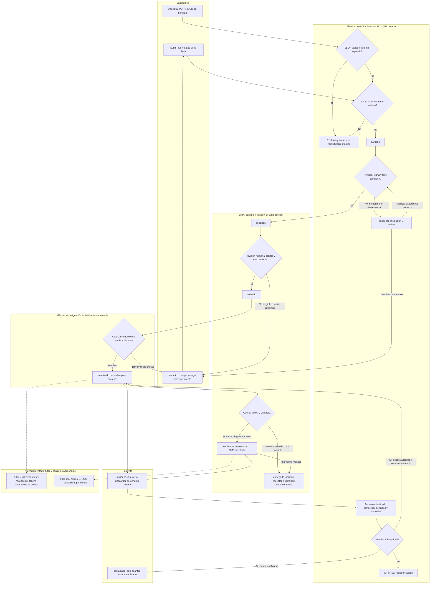
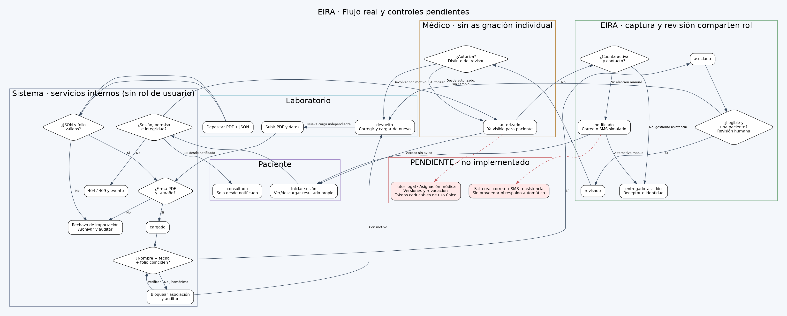

# Flujo de entrega: implementación y límites

Fuente: `resultados/models.py`, `servicios.TRANSICIONES`, `puede_ver_documento` y decoradores de `views.py`.
Los identificadores de estado son los reales. Las líneas discontinuas indican tareas pendientes, **no funciones existentes**.
El PNG equivalente se genera con Graphviz: `dot -Tpng docs/diagrama_flujo.dot -o docs/diagrama_flujo.png`.
Se usó Graphviz porque no hay Node/npx en el entorno. No se añadieron dependencias a la aplicación.

## Matriz de permisos observados (no matriz ideal)

| Acción | Laboratorio | EIRA | Médico | Paciente | Tutor | Sistema |
|---|---|---|---|---|---|---|
| Cargar PDF / importar bandeja | Sí | Sí | No | No | Ausente | Importador con usuario laboratorio/EIRA |
| Asociar identidad | No | Cargado→asociado | No | No | Ausente | Compara nombre + fecha + folio |
| Revisión administrativa | No | Asociado→revisado | No | No | Ausente | Valida transición |
| Autorizar clínicamente | No | No | Revisado→autorizado, distinto del revisor | No | Ausente | No comprueba asignaciones ni cargador |
| Devolver con motivo | No | Desde cargado/asociado | Desde revisado | No | Ausente | Devuelto no tiene transición de salida |
| Notificar correo/SMS | No | Desde autorizado | No | No | Ausente | Simulación; sin proveedor ni respaldo automático |
| Registrar entrega asistida | No | Desde autorizado/notificado | No | No | Ausente | Exige receptor y verificación no vacíos |
| Leer/descargar PDF | Solo cargas propias del usuario | Todos, incluso sin autorizar | Todos, incluso sin autorizar | Sin cuenta: enlace del aviso + fecha de nacimiento + código; solo ese resultado | Ausente | Comprueba sesión o enlace verificado, caducidad e integridad |
| Panel, detalle, avisos y bitácora | No | Todos | Todos | No | Ausente | Audita descargas y algunos rechazos |
| Modificar/borrar bitácora | No por instancia | No por instancia | No por instancia | No por instancia | Ausente | ORM masivo puede alterar: brecha |

## Advertencias para la demostración

- No hay roles separados de captura y revisión EIRA, laboratorio como entidad, tutor ni asignación médico-paciente.
- El alcance del laboratorio se limita al **usuario cargador**, no a una organización de laboratorio.
- Ilegibilidad y varias pacientes dependen de revisión humana; la firma `%PDF-` no valida contenido.
- Una devolución obliga a una nueva carga independiente: no hay vínculo de versiones, corrección ni anulación de la anterior.
- No hay estado pendiente de identidad ni rechazado separado: el documento permanece cargado o se devuelve.
- Los avisos son plantillas fijas simuladas: no se prueba entrega real. La paciente entra por enlace (72 h) con fecha de nacimiento y código; 3 errores bloquean el enlace. El aviso se envía al autorizar; el reintento usa otro canal y tras 2 fallos queda entrega asistida.
- Tras verificar, el PDF puede volver a descargarse durante la sesión de 30 minutos: no es de un solo uso.
- `expectedFailure` mantiene la suite ejecutable, pero cada ❌ del informe es un contrato de seguridad incumplido, no una validación aprobada.
