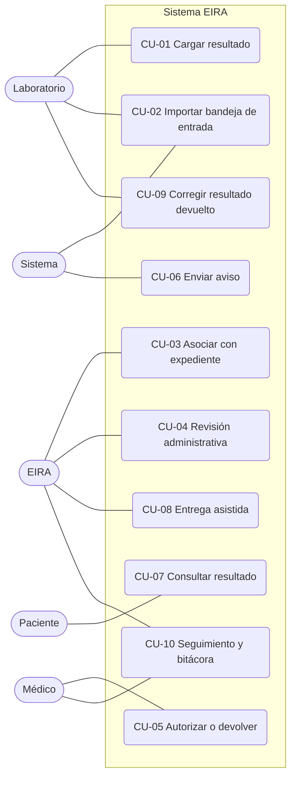

# 01 · Casos de uso

## Actores

| Actor | Descripción | En el prototipo |
|---|---|---|
| Laboratorio | Procesa la muestra y entrega el PDF del resultado | Usuario `laboratorio@lab.test`; carga manual o bandeja de entrada |
| EIRA (administración) | Asocia el resultado con el expediente, revisa, avisa y registra entregas asistidas | Usuario `admin@eira.test` |
| Médico | Autoriza clínicamente la entrega o la devuelve | Usuario `medico@eira.test` |
| Paciente | Recibe el aviso y consulta su resultado | Sin cuenta: enlace único + fecha de nacimiento + código |
| Sistema | Valida archivos, envía avisos, controla estados y bitácora | Servicios internos (`resultados/servicios.py`) |
| Tutor o representante legal | Recibe el resultado de una paciente menor o representada | **Pendiente** |

## Diagrama de casos de uso

## Casos de uso

### CU-01 · Cargar resultado
- **Actor:** Laboratorio (también EIRA).
- **Precondición:** sesión iniciada con rol laboratorio o EIRA.
- **Flujo principal:** 1) sube el PDF y captura nombre, fecha de nacimiento y folio de expediente tal como vienen en la hoja, más el folio de laboratorio; 2) el sistema valida firma `%PDF-` y tamaño, calcula SHA-256 y guarda el archivo con nombre aleatorio en almacenamiento privado; 3) el resultado queda **Cargado** y se registra en bitácora.
- **Alternativos:** archivo que no es PDF o excede tamaño → se rechaza con mensaje.
- **Postcondición:** resultado en estado `cargado`, visible solo para quien lo cargó (dentro del laboratorio).
- **Brechas conocidas:** la carga manual no bloquea un folio o hash repetido; la firma PDF no garantiza que el contenido sea legible.

### CU-02 · Importar bandeja de entrada
- **Actor:** Sistema (a pedido del laboratorio o cada N segundos con `--vigilar`).
- **Flujo principal:** el laboratorio deja `R1.pdf` + `R1.json` en la carpeta compartida; el sistema espera a que el archivo deje de cambiar, lo reclama, aplica las mismas validaciones que CU-01 y lo mueve a `procesados/`.
- **Alternativos:** sin `.json`, datos incompletos, folio repetido o no es PDF → se mueve a `rechazados/` con `.motivo.txt` y evento en bitácora.

### CU-03 · Asociar con expediente
- **Actor:** EIRA.
- **Flujo principal:** el sistema propone candidatos; EIRA elige el expediente; se comparan nombre normalizado, fecha de nacimiento y folio; si coinciden → **Asociado**.
- **Alternativos:** homónimo o discrepancia → se bloquea la asociación y se audita; EIRA verifica otro expediente o **devuelve** con motivo al laboratorio.

### CU-04 · Revisión administrativa
- **Actor:** EIRA.
- **Flujo principal:** verifica que el documento sea legible y corresponda a una sola paciente → **Revisado**.
- **Alternativo:** ilegible o con varias pacientes → **Devuelto** con motivo.
- **Brecha:** el control de “una sola paciente” depende de la revisión humana; no hay campo explícito.

### CU-05 · Autorizar o devolver
- **Actor:** Médico.
- **Precondición:** resultado `revisado`; el médico no puede ser quien lo revisó.
- **Flujo principal:** autoriza (opcionalmente marca “requiere contacto”) → **Autorizado**; el sistema dispara CU-06.
- **Alternativo:** devuelve con motivo → **Devuelto**.
- **Brechas:** no hay asignación médico–paciente; la identidad que cargó podría autorizar si cambia de rol.

### CU-06 · Enviar aviso
- **Actor:** Sistema.
- **Flujo principal:** al autorizar, si la paciente prefiere entrega digital y tiene contacto, se crea un enlace único (vigencia 72 h) y se envía un aviso **sin información clínica** por correo o SMS → **Notificado**.
- **Alternativos:** preferencia asistida o sin contacto → “Requiere entrega asistida” (CU-08); fallo del aviso → EIRA reintenta por el otro canal (el reintento invalida el enlace anterior); tras 2 fallos → entrega asistida.
- **Estado:** los envíos son **simulados** (bandeja “Avisos simulados”).

### CU-07 · Consultar resultado (paciente)
- **Actor:** Paciente.
- **Flujo principal:** 1) abre el enlace; 2) escribe su fecha de nacimiento; 3) recibe un código de 6 dígitos (vigencia 10 min) por el canal contrario al del enlace; 4) con el código correcto ve y descarga su PDF → **Consultado**; la bitácora guarda el acuse (canales, destino enmascarado, hora e IP).
- **Alternativos:** enlace vencido o inválido → página de acceso inválido; 3 errores de fecha o código → enlace bloqueado y pasa a entrega asistida.
- **Brecha:** tras verificar, el PDF puede descargarse otra vez durante la sesión de 30 min.

### CU-08 · Entrega asistida
- **Actor:** EIRA.
- **Flujo principal:** entrega en persona o por contacto directo; registra receptor y cómo verificó su identidad (obligatorios) → **Entrega asistida**.

### CU-09 · Corregir resultado devuelto
- **Actor:** Laboratorio.
- **Flujo principal:** consulta el motivo y carga un documento nuevo (CU-01).
- **Brecha:** no hay versiones: el nuevo documento no queda vinculado al devuelto ni lo revoca.

### CU-10 · Seguimiento y bitácora
- **Actores:** EIRA y médico.
- **Flujo principal:** panel por secciones (pendientes / autorizados) con avance, responsable actual y tiempo en etapa; detalle con historial; bitácora de solo inserción.
- **Brecha:** la bitácora se protege a nivel de instancia, pero una actualización masiva por ORM podría alterarla; falta protección en base de datos.

## Casos de uso pendientes (fuera del prototipo)

| ID | Caso | Por qué importa |
|---|---|---|
| CU-11 | Entrega a tutor o representante legal | Pacientes menores o con representación |
| CU-12 | Corrección versionada y revocación | Evitar que la paciente vea una versión anterior errónea |
| CU-13 | Asignación médico–paciente | Limitar quién puede leer y autorizar |
| CU-14 | Integración con proveedores reales de correo/SMS con acuse de entrega | Respaldo correo → SMS → asistida basado en fallas reales |
