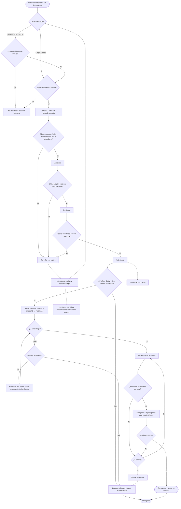
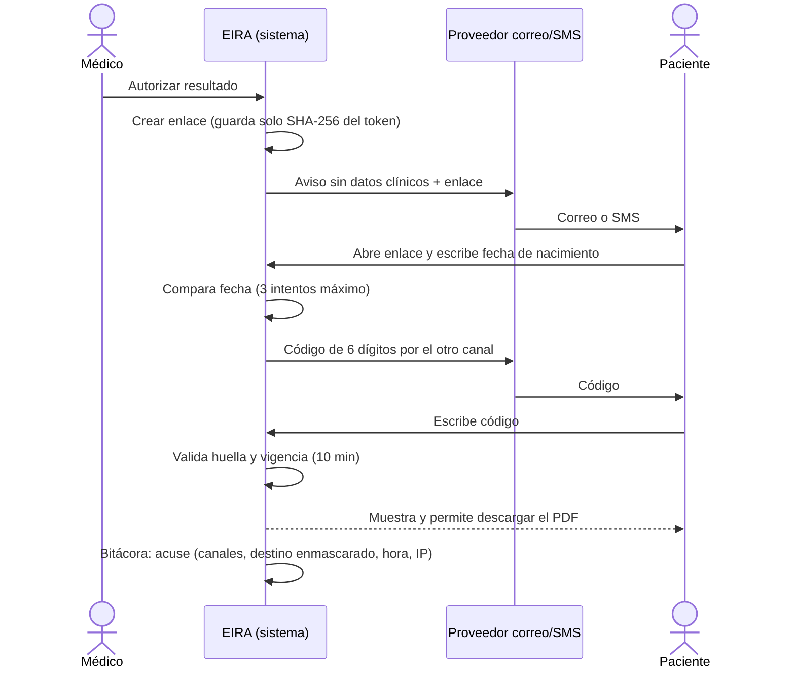
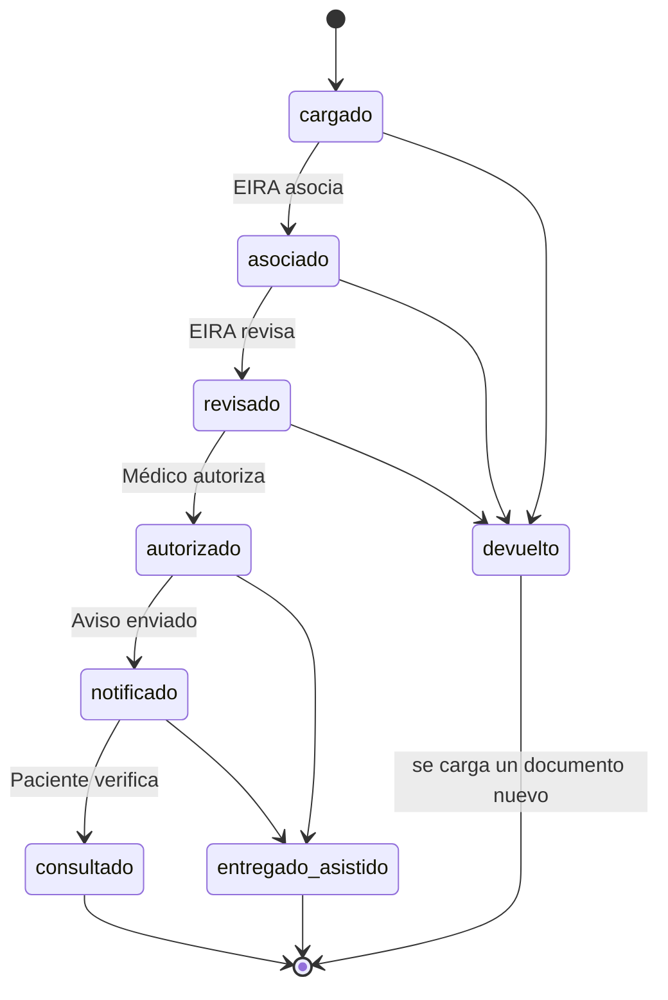

# 02 · Diagrama de flujo

Vista de proceso para presentar la propuesta. El detalle técnico con permisos reales está en [diagrama_flujo.md](../diagrama_flujo.md). Las líneas discontinuas son **pendientes**, no funciones existentes.

## Proceso de punta a punta

## Secuencia del acceso de la paciente

## Estados del documento

