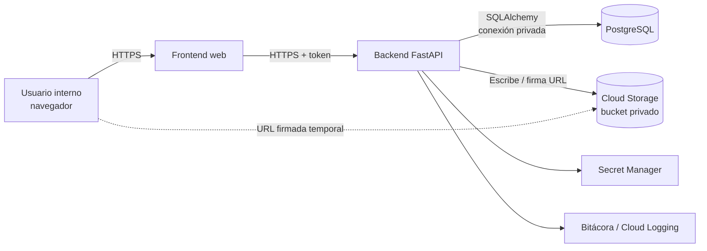

# 02 · Arquitectura candidata

> Punto de partida a evaluar en la Fase 1, no una decisión cerrada.

| Capa | Candidato | Por qué |
|---|---|---|
| Frontend | Aplicación web | Acceso desde cualquier ubicación |
| Backend | Python + FastAPI | Tipado, validación con Pydantic, OpenAPI automático |
| ORM | SQLAlchemy | Maduro, soporta PostgreSQL y transacciones |
| Base de datos | PostgreSQL (Cloud SQL) | Modelo muy relacional (N:M, históricos) |
| Migraciones | Flyway | Versionado SQL explícito y repetible |
| Archivos | Cloud Storage (bucket privado) | No guardar binarios en la BD |
| Secretos | Secret Manager | Sin credenciales en código ni variables versionadas |
| Ejecución | A evaluar (p. ej. Cloud Run) | Pago por uso, sin servidores que mantener |

Fuera de alcance sin justificación: microservicios, Kubernetes, Redis, colas de mensajes.

## Diagrama

## Recorrido de una solicitud

**Consultar un expediente**

1. El usuario inicia sesión; el backend valida credenciales y emite una sesión o token.
2. El frontend pide `GET /pacientes/{id}`.
3. El backend verifica la autenticación y el **permiso por rol** del usuario.
4. Consulta PostgreSQL dentro de una transacción de solo lectura.
5. Registra el acceso al expediente en la bitácora.
6. Devuelve solo los campos que el rol puede ver.

**Ver una radiografía**

1. El frontend pide `GET /archivos/{id}/url`.
2. El backend valida el permiso y busca `bucket` + `object_key` en la BD.
3. Genera una **URL firmada de corta duración** y registra el acceso.
4. El navegador descarga directamente desde Cloud Storage.

**Subir un archivo**

1. El frontend envía el archivo (o pide una URL firmada de subida).
2. El backend valida tipo MIME y tamaño, guarda el objeto con una clave no adivinable.
3. Registra los metadatos en la tabla de archivos en la misma operación lógica.

## Entornos

| Entorno | Datos | Notas |
|---|---|---|
| Local | Sintéticos | PostgreSQL en contenedor o local |
| Desarrollo/pruebas | Sintéticos | Recursos mínimos |
| Producción | Reales | Respaldos, acceso restringido, bitácora activa |
