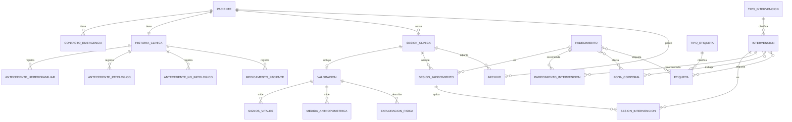

# 03 · FASE 2 — Modelo de dominio (esquema general)

> Esquema conceptual. Los nombres de tablas son tentativos y se confirman al cerrar esta fase.

## Módulos

| Módulo | Entidades principales |
|---|---|
| Pacientes | `paciente`, `contacto_emergencia` |
| Historia clínica | `historia_clinica`, `antecedente_heredofamiliar`, `antecedente_patologico`, `antecedente_no_patologico`, `medicamento_paciente` |
| Valoración | `valoracion`, `signos_vitales`, `medida_antropometrica`, `exploracion_fisica` |
| Catálogos clínicos | `padecimiento`, `zona_corporal`, `etiqueta`, `tipo_etiqueta`, `tipo_intervencion`, `intervencion` |
| Recomendaciones | `padecimiento_intervencion` (catálogo, **no** ejecución) |
| Sesiones | `sesion_clinica`, `sesion_padecimiento`, `sesion_intervencion` |
| Archivos | `archivo`, `tipo_archivo` |
| Seguridad | `usuario`, `rol`, `bitacora` |

## Regla principal: sesiones

```
PACIENTE 1:N SESION_CLINICA 1:N SESION_PADECIMIENTO 1:N SESION_INTERVENCION
```

- `sesion_padecimiento`: el padecimiento (del catálogo) atendido en **esa** sesión, con su información clínica específica.
- `sesion_intervencion`: lo que **realmente se hizo** para ese padecimiento: series, repeticiones, duración, intensidad, observaciones, indicaciones.
- Una sesión puede atender varios padecimientos; cada uno con sus propias intervenciones.

## Recomendado vs. ejecutado

| Concepto | Tabla | Significado |
|---|---|---|
| Recomendación | `padecimiento_intervencion` | Configuración del catálogo: "para lumbalgia se sugiere X" (prioridad, observaciones, activo) |
| Ejecución | `sesion_intervencion` | Registro clínico: "a la paciente 15, en la sesión 1, se le aplicó X" |

Nunca reutilizar la misma tabla para ambas cosas.

## Relaciones N:M (tablas puente)

| Puente | Une |
|---|---|
| `padecimiento_zona` | padecimiento ↔ zona_corporal |
| `padecimiento_etiqueta` | padecimiento ↔ etiqueta |
| `intervencion_zona` | intervencion ↔ zona_corporal |
| `intervencion_etiqueta` | intervencion ↔ etiqueta |
| `padecimiento_intervencion` | padecimiento ↔ intervencion (con atributos) |

## Diagrama conceptual



## Decisiones a tomar en esta fase

Para cada una: opción elegida, alternativa descartada y por qué.

| # | Decisión | Opciones |
|---|---|---|
| D1 | Valoración inicial | Entidad independiente vs. valoración ligada a la primera sesión |
| D2 | Diagnósticos/tratamientos anteriores | Texto libre en V1 vs. entidades propias |
| D3 | Medicamentos | Texto por paciente vs. catálogo de medicamentos |
| D4 | IMC | Calculado al consultar vs. columna generada vs. almacenado |
| D5 | Circunferencias | Columna única vs. registro por zona/tipo de medición |
| D6 | Tipos de etiqueta | Catálogo `tipo_etiqueta` vs. sin clasificación |
| D7 | Valores fijos (sexo, estado civil, factores Bueno/Regular/Malo) | ENUM de PostgreSQL vs. catálogo relacional vs. CHECK |
| D8 | Archivos | Ligados al paciente, a la sesión o a ambos (sesión opcional) |

## Entregables de la fase

- [ ] Modelo conceptual aprobado.
- [ ] Diagrama ER completo con cardinalidades.
- [ ] Diccionario de datos (tabla, columna, tipo, nulo, descripción, regla).
- [ ] Reglas de negocio numeradas (RN-01, RN-02…).
- [ ] Lista de entidades que todavía necesitan validación clínica.

### Formato sugerido del diccionario de datos

| Tabla | Columna | Tipo | Nulo | Default | Descripción | Regla |
|---|---|---|---|---|---|---|
| `signos_vitales` | `ta_sistolica` | `SMALLINT` | Sí | — | Presión sistólica en mmHg | CHECK rango a definir |
